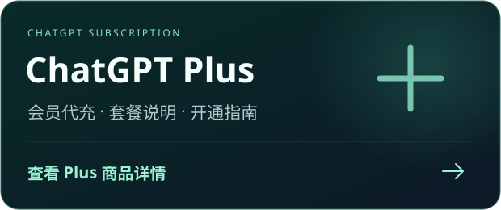
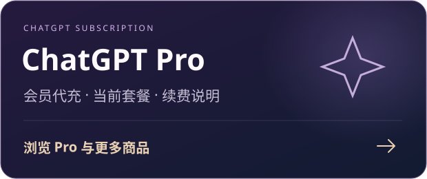
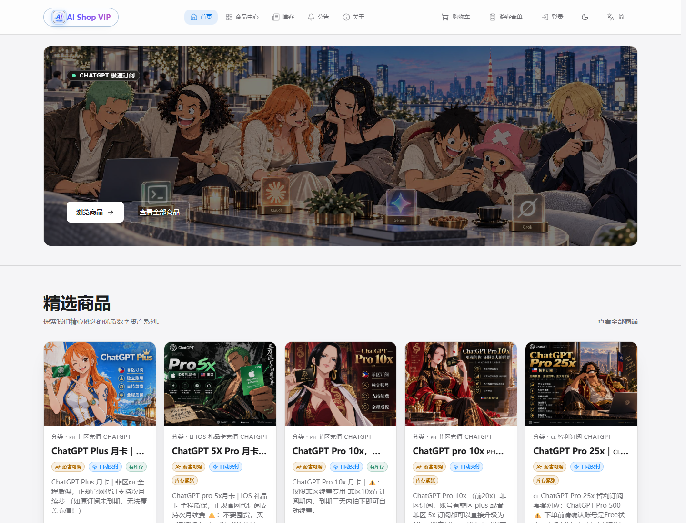
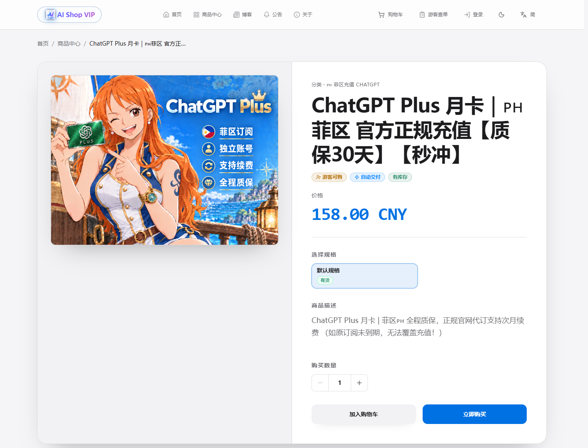
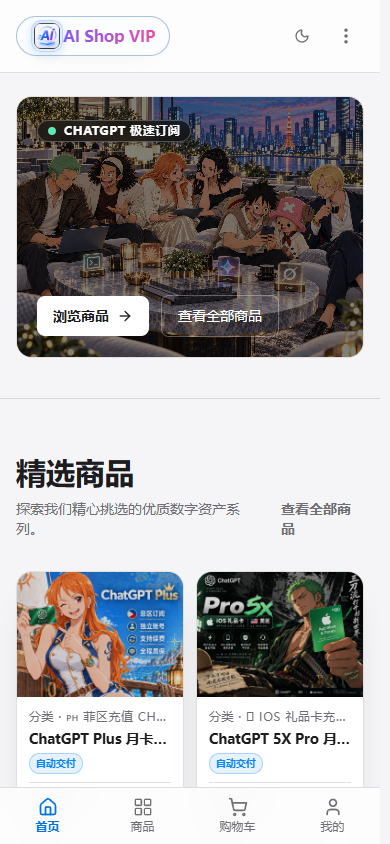

> **Chatgpt代充：[aishopvip.com](https://aishopvip.com)**

  

# ChatGPT 代充与充值指南｜AIShopVIP

<strong>ChatGPT Plus / Pro 会员服务 · 中文充值指南 · 店铺客服支持</strong>

**面向在 ChatGPT 订阅付款环节遇到困难的中文用户，整理代充入口、充值流程、续费说明和常见问题。**

[AIShopVIP（AI Shop VIP）](https://aishopvip.com/) 是本仓库介绍的代理店铺。可以在网站查看当前商品、适用账号条件、办理方式与售后说明，再选择适合自己的服务。

  <strong><a href="https://aishopvip.com/">🌐 访问 AIShopVIP</a>　 · 　<a href="https://aishopvip.com/products">🛍️ 查看商品</a>　 · 　<a href="docs/recharge-guide.md">📖 充值指南</a>　 · 　<a href="docs/faq.md">💬 常见问题</a></strong>

简体中文 | [English](README.en.md)

## 选择你的 ChatGPT 会员服务

  
  

## 快速找到你需要的内容

| 你的需求 | 对应入口 |
| --- | --- |
| 了解 ChatGPT Plus 代充 | [Plus 商品详情](https://aishopvip.com/products/chatgpt-plus) |
| 查看 ChatGPT Pro 等当前套餐 | [商品中心](https://aishopvip.com/products) |
| 第一次充值，不知道如何下单 | [充值与订阅指南](docs/recharge-guide.md) |
| 已有订阅，想了解续费或升级 | [续费前需要确认什么](docs/recharge-guide.md#续费与升级前需要确认什么) |
| 付款或充值遇到问题 | [常见问题](docs/faq.md) · [网站公告](https://aishopvip.com/notice) |
| 查看店铺联系方式 | [联系店铺](https://aishopvip.com/about) |

## 提供哪些 ChatGPT 订阅服务？

网站当前展示 ChatGPT Plus 和 Pro 相关商品。不同商品可能采用不同的充值方式，对账号已有订阅、订阅地区、开通或续费状态也可能有不同要求。

以当前 [Plus 商品页面](https://aishopvip.com/products/chatgpt-plus) 为例，页面说明为客户本人账号开通订阅，并提示原订阅未到期时不能直接覆盖充值。**这些条件不能直接套用到其他套餐，请以所选商品详情为准。**

本仓库不固定列出价格、库存或到账时间，方便你始终从网站查看最新信息。

## 如何充值 ChatGPT？

1. **先选服务。** 打开 [商品中心](https://aishopvip.com/products)，区分 Plus / Pro、首次开通、续费或其他办理方式。
2. **核对账号条件。** 阅读商品描述，确认现有订阅状态、适用地区和是否需要等待原订阅到期。
3. **按页面完成下单。** 付款方式、需要提供的信息和后续操作，均以网站当前指引为准。
4. **保存订单并确认结果。** 按交付说明办理后，在自己的 ChatGPT 账号中检查订阅状态；如有疑问，通过网站客服处理。

详细步骤见 **[ChatGPT 充值与订阅指南](docs/recharge-guide.md)**。

## 网站实拍

以下截图来自 **2026 年 10 月 21 日** 对网站公开页面的实际访问，展示首页与商品说明的样子。截图里的价格、库存及商品文案是当时的页面内容，当前信息请打开网站确认。

展开查看 ChatGPT Plus 商品详情页截图

展开查看手机端首页截图

## 常见问题

### 中国用户不方便给 ChatGPT 付款，可以从哪里了解代充服务？

可以先在 [AIShopVIP](https://aishopvip.com/) 查看服务和商品说明，再核对自己的账号是否满足办理条件。是否适用需要结合具体套餐判断。

### ChatGPT Plus 和 Pro 都能在这里查看吗？

网站当前展示两类相关商品。Plus 可查看 [商品详情](https://aishopvip.com/products/chatgpt-plus)，Pro 的可售套餐请查看 [商品中心](https://aishopvip.com/products)。

更多问题见 **[完整 FAQ](docs/faq.md)**。

## 联系与售后

以下为网站公开展示的联系入口，页面如有更新，以网站为准：

- **微信：** `jedliuai`
- **Telegram：** [@jedliu8](https://t.me/jedliu8)
- **最新通知：** [网站公告](https://aishopvip.com/notice)
- **联系页面：** [联系店铺](https://aishopvip.com/about)
- **服务说明：** [服务条款](https://aishopvip.com/terms) · [隐私政策](https://aishopvip.com/privacy)

订单与账号问题请通过网站客服处理。GitHub Issues 只用于反馈本仓库中的错字、失效链接和说明不清楚的地方，提交方式见 [参与完善](CONTRIBUTING.md)。

## 关于本仓库

本仓库收录 AIShopVIP 的公开服务介绍、ChatGPT 充值指南和 FAQ，方便通过 GitHub 查找、阅读和反馈。网站截图的拍摄日期、说明文档的更新日期均单独标注。

**最近核对：2026-10-21。** 套餐与服务以 [aishopvip.com](https://aishopvip.com/) 的当前说明为准。
